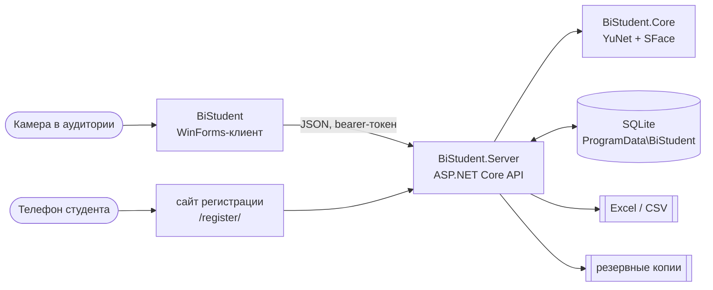

<div align="center">

# BiStudent

Электронный журнал преподавателя колледжа: посещаемость отмечается по распознаванию лиц, оценки и итог ведутся там же, журнал выгружается в Excel для печати.


</div>

## Зачем

Перекличка в начале пары занимает пять минут, бумажный журнал потом переписывают в Excel, а пропуски по уважительной причине теряются между справками и сообщениями. BiStudent отмечает присутствующих камерой в аудитории, ведёт оценки в том же журнале и в конце семестра выдаёт готовый лист для печати.

## Что умеет

**Отметка посещаемости.** Камера в аудитории распознаёт студентов группы и ставит «П», остальным в конце занятия ставится «Н». Преподаватель видит, кого программа узнала, и может исправить любую отметку вручную.

**Уважительные причины.** Пропуск можно оформить как уважительный: болезнь, семейные обстоятельства, учебная или служебная необходимость, другое. К причине прилагаются отметка о документе и комментарий, в журнале такое «Н» выделено жёлтым.

**Журнал.** Посещаемость, баллы за занятия по 100-балльной шкале, контрольные мероприятия (тесты, контрольные работы, экзамены, зачёты) и итоговый балл. Справа считаются пропущенные часы, процент посещаемости и средний балл. «Скачать Excel» формирует лист для печати с шапкой, обозначениями и строкой подписи.

**Регистрация лиц по коду.** Преподаватель выдаёт группе код или QR-код. Студенты сами делают три снимка на сайте с телефона или компьютера, сервер сразу проверяет качество, преподаватель подтверждает заявку.

**Импорт.** Списки групп загружаются из журнала Excel или CSV, расписание из файла колледжа. При импорте расписания для новых преподавателей создаются учётные записи.

**Учётные записи и копии.** Администратор заводит преподавателей и выдаёт временные пароли. Сервер раз в сутки делает резервную копию, вручную её можно скачать и восстановить в разделе «Администрирование».

## Запуск

Нужны Windows x64 и .NET 10 SDK.

```powershell
git clone https://github.com/logreus-cloud/BiStudent
cd BiStudent
.\scripts\run-demo.ps1 -Demo     # демо-данные на пустой базе, вход teacher / teacher123
```

Скрипт собирает решение, поднимает сервер на порту 5080 и открывает клиент преподавателя. Когда клиент закрывается, сервер останавливается.

<details>
<summary>Остальные режимы и команды</summary>

| Команда | Что делает |
|---|---|
| `.\scripts\run-demo.ps1` | рабочий режим: пустая база, вход `admin` / `admin` со сменой пароля |
| `.\scripts\run-demo.ps1 -Demo` | на пустой базе создаёт демо-данные: группы, расписание, историю посещаемости и оценок |
| `.\scripts\run-demo.ps1 -Reset` | удаляет базу перед запуском, все данные будут потеряны |
| `docker compose up -d --build` | сервер в Docker на `http://localhost:5080`, база в томе `bistudent-data` |
| `dotnet test --solution BiStudent.slnx` | тесты сервера (`BiStudent.Tests`) и клиента (`BiStudent.Client.Tests`) |
| `node --test tests/site/register.test.cjs` | тесты сайта регистрации лица |
| `BiStudent.exe --self-test` | без сервера проверяет модели, камеры и окно входа, результат в `diagnostics/result.txt` |
| `BiStudent.exe --screenshots <адрес> <логин> <пароль>` | входит на сервер и сохраняет скриншоты всех разделов в `diagnostics/` |

</details>

Сервер слушает порт 5080 во всей локальной сети, чтобы студенты могли открыть сайт регистрации с телефона. При первом запуске Windows может спросить разрешение для брандмауэра.

Модель SFace (38 МБ) не хранится в репозитории: при первой сборке её скачивает `BiStudent.Core.csproj` из OpenCV Zoo (запасной адрес Hugging Face) и проверяет по SHA-256. Без интернета положите `face_recognition_sface_2021dec.onnx` в `BiStudent.Core/Models` вручную.

## Устройство



| Часть | Технологии | Что делает |
|---|---|---|
| `BiStudent` | WinForms, .NET 10 | клиент преподавателя: «Сегодня», «Отметка», «Расписание», «Журнал», «Группы», «Отчёт», «Администрирование»; камера подключается локально, кадры уходят на сервер |
| `BiStudent.Server` | ASP.NET Core, EF Core, SQLite, ClosedXML | REST API с bearer- и refresh-токенами, журнал и оценки, импорт и выгрузка Excel/CSV, статистика, распознавание, сайт `/register/` |
| `BiStudent.Core` | OpenCvSharp | `FaceEngine`, ONNX-модели и общие контракты API |
| `BiStudent.Tests`, `BiStudent.Client.Tests` | xUnit v3 | тесты сервисов, API и клиента |

<details>
<summary>Почему так</summary>

- Клиент и сервер разделены: камера и интерфейс остаются на компьютере преподавателя, а база, распознавание и сайт регистрации живут на одном сервере, к которому могут подключиться несколько преподавателей и телефоны студентов.
- База лежит в `C:\ProgramData\BiStudent`, отдельно от папки программы, поэтому обновление сборки не сбрасывает данные и пароли. Структура обновляется миграциями EF Core, базы прошлых версий переносятся без потери данных.
- Биометрия не покидает сервер. Хранятся только выровненные образцы лица 112×112, зашифрованные ASP.NET Data Protection; полные кадры с камеры и сайта не сохраняются.
- Студент регистрирует лицо сам, но в распознавании участвуют только снимки, которые подтвердил преподаватель.
- Пароли хранятся хешами. «Запомнить меня» сохраняет refresh-токен, зашифрованный Windows DPAPI для текущего пользователя; смена пароля завершает сохранённые сессии.

</details>

## Регистрация лица

1. «Группы» → выберите группу → **Код регистрации**. Код один на всю группу и действует от 1 часа до 7 дней.
2. Студент сканирует QR-код или открывает `http://<IP сервера>:5080/register/` и вводит код.
3. Студент находит себя в списке, даёт согласие на обработку биометрических данных и делает три снимка: прямо, чуть влево, чуть вправо.
4. Преподаватель открывает **Заявки на регистрацию**, смотрит снимки и подтверждает или отклоняет заявку.

Браузер телефона даёт доступ к камере только по HTTPS. В локальной сети без HTTPS сайт предлагает сделать снимки приложением камеры и загрузить их файлами. Для HTTPS-адреса укажите `Enrollment:PublicUrl`.

## Импорт списков и расписания

**Списки групп**: «Группы» → «Импорт списков». Принимает журнал Excel (лист — группа, ФИО в колонке «ФИО», строки вроде «куратор: …» пропускаются) или CSV `ФИО;Группа`. Повторный импорт не создаёт дублей.

**Расписание колледжа**: «Расписание» → «Импорт» → «Расписание Excel…», нужны права администратора.

<details>
<summary>Формат файла расписания</summary>

- На каждую группу блок колонок «день · звонок · № пары · аудитория · группа». В ячейке строка вида `[ПРАКТИКА] Предмет · аудитория · нед. 2-4, 8 (разово)`, строкой ниже преподаватели.
- Диапазон недель становится еженедельным занятием, «(разово)» разовым. Дата недели считается от начала семестра из заголовка файла.
- СРОП импортируется как занятие по своей дисциплине. Совместные занятия («с 23-ПО-103-4р-2») попадают в обе группы.
- Для новых преподавателей создаются учётные записи (логин из фамилии и инициалов, например `niyazova.me`) с временными паролями. Пароли показываются один раз. «Вакансия» получает отключённую учётную запись.
- Повторный импорт того же файла пропускает существующие занятия, нераспознанные записи перечисляются после импорта.
- Демо на реальных данных: положите `BiStudent.Server/seed/students.local.csv` и `seed/schedule.local.xlsx` (в git не попадают), и `run-demo.ps1 -Demo` на пустой базе импортирует реальные группы и расписание.

</details>

## Данные и приватность

| Что | Где и как |
|---|---|
| База и ключи шифрования | `C:\ProgramData\BiStudent`; другой каталог задаётся через `Storage:DataDirectory`, строка подключения через `ConnectionStrings:Default` |
| Образцы лиц | только на сервере, 112×112, зашифрованы; снимки заявки удаляются после её рассмотрения |
| Резервные копии | раз в сутки, последние 7 в `<каталог данных>/backups`; zip с базой и ключами, **храните его как пароль** |
| Удаление студента | удаляет его образцы, заявки, отметки и оценки |

Камеру и регистрацию лиц используйте только с согласия студентов и учебного заведения.

## Ограничения

- Сильный поворот головы, плохой свет и закрытое лицо мешают распознаванию. Отсутствие отметки значит только, что студента не удалось надёжно узнать.
- **Программа не проверяет, что перед камерой живой человек:** фотография на телефоне может дать ложную отметку. Отметки проверяет и при необходимости исправляет преподаватель.
- Съёмка прямо на сайте регистрации работает только по HTTPS.

## CI

GitHub Actions (`.github/workflows/ci.yml`) на каждый push и PR собирает решение с `-warnaserror`, запускает тесты .NET и сайта регистрации, выполняет самотест клиента и собирает Docker-образ сервера с проверкой `/health`. Push в `main` дополнительно публикует self-contained сборки клиента и сервера для win-x64.

## Лицензии компонентов

- Детектор лиц [YuNet](https://github.com/opencv/opencv_zoo/tree/main/models/face_detection_yunet): MIT, [`BiStudent.Core/Models/LICENSE-YUNET.txt`](BiStudent.Core/Models/LICENSE-YUNET.txt).
- Модель распознавания [SFace](https://github.com/opencv/opencv_zoo/tree/main/models/face_recognition_sface): Apache 2.0, [`BiStudent.Core/Models/LICENSE-SFACE.txt`](BiStudent.Core/Models/LICENSE-SFACE.txt).
- Портреты для тестов: официальные фото NASA, общественное достояние, источники в [`BiStudent.Tests/Fixtures/Faces/README.md`](BiStudent.Tests/Fixtures/Faces/README.md).
